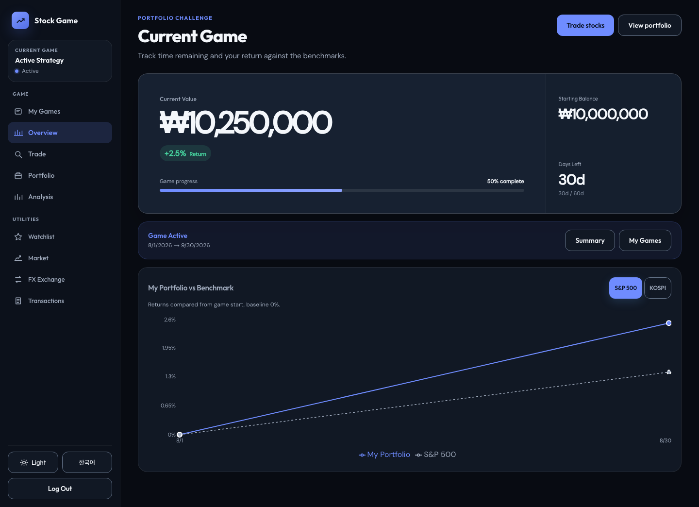

# Stock Game

Paper trading for Korean and US stocks, with separate investment challenges and benchmark comparisons.

**[Live app](https://stock-game-gray.vercel.app)**

Choose a starting balance and duration, trade virtual KRW/USD funds, and compare results with the KOSPI and S&P 500. Prices come from Yahoo through yfinance; orders and money are simulated, with no brokerage execution.

Try `demo` / `demo1234`. This is an intentionally public, shared account: visitors can change it, and backend startup resets its baseline. Free hosting can make the first request slow.



Screenshot uses fixed test fixtures, not production user data.

## Engineering decisions

- Each game owns cash, holdings, transactions and valuation snapshots. Shared ownership checks hide other users’ sessions with a 404; watchlists remain user-level.
- Trading resolves session lifecycle before mutation. Ended games retain saved results and reject new trades; client portfolio scopes separate session and legacy query paths.
- Keyed buy, sell and exchange requests can replay an existing order without duplicating it. The browser keeps the key for an open ticket; closing it and submitting again creates a new order.

React · Vite · TanStack Query · FastAPI · SQLAlchemy · PostgreSQL (production) / SQLite (local) · Vercel + Render

## Run locally

Use Python 3.11 and Node 20.19+ or 22.13+. Start the backend and frontend in separate terminals.

```bash
cd backend
python3.11 -m venv venv
venv/bin/pip install -r requirements.txt -r requirements-dev.txt
test -e .env || cp .env.example .env
# Set JWT_SECRET_KEY in .env before starting.
venv/bin/uvicorn app.main:app --reload
```

```bash
cd frontend
npm ci --no-audit
npm run dev
```

Local development defaults to SQLite and the API at `http://127.0.0.1:8000`. See [backend configuration](backend/.env.example). Production builds require `VITE_API_URL`, `DATABASE_URL` and the matching `FRONTEND_URL`; interactive API docs and developer fund controls stay disabled by default.

## Scope and checks

Quotes can be unavailable or stale; yfinance is unofficial.

[Verification script](scripts/check.sh) · [Regression smoke and QA limits](REGRESSION_SMOKE.md) · [Verified project record](PROJECT_STATUS.md) · [Maintenance policy](MAINTENANCE.md) · [Decisions](docs/DECISIONS.md)

## License

Copyright (c) 2026 Michael Ju. All rights reserved.
No license is granted for use, copying, modification, or distribution of this code as of 2026-07-30. This repository is public for portfolio review purposes only.
